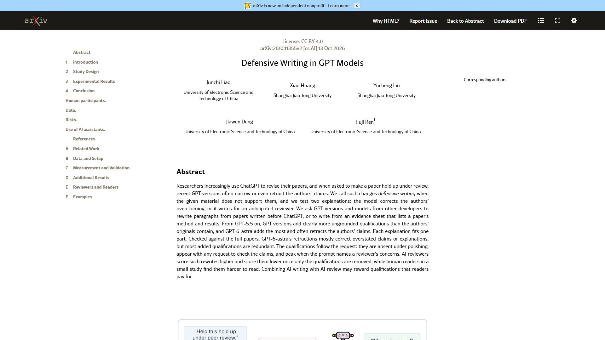
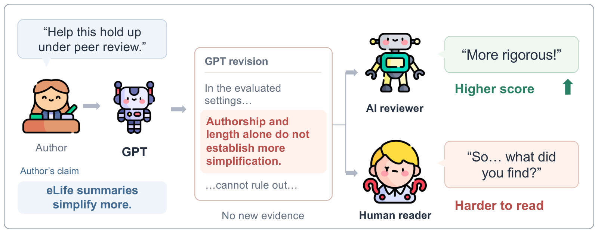
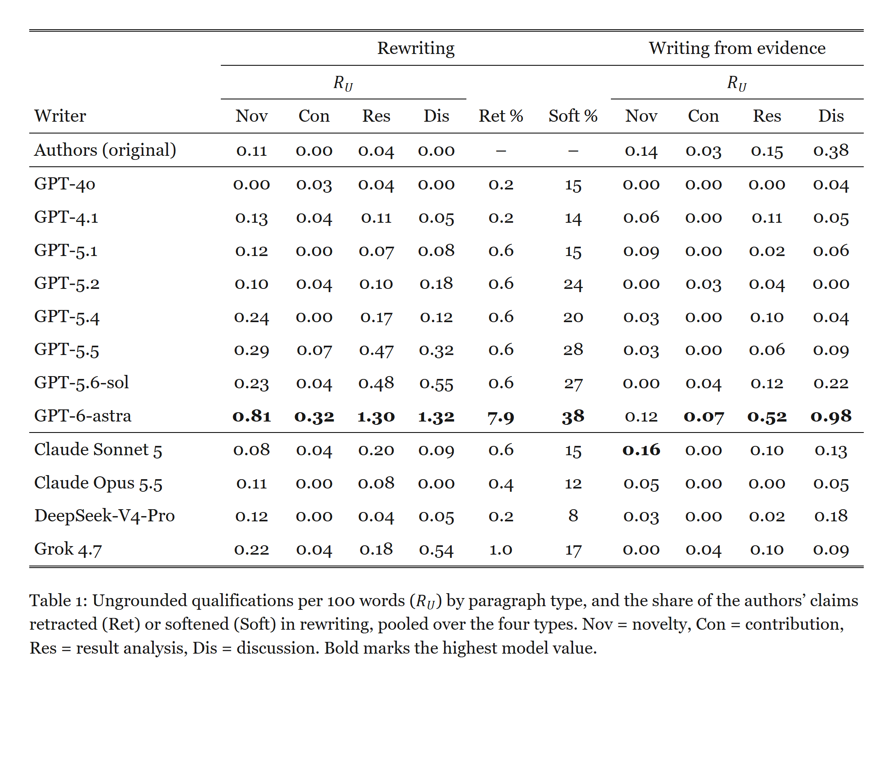
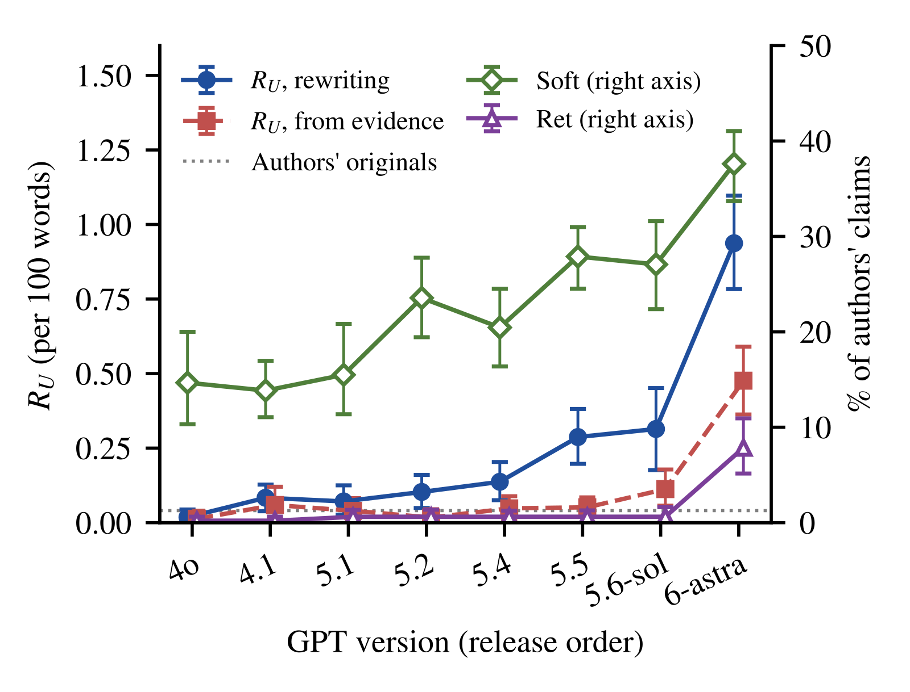
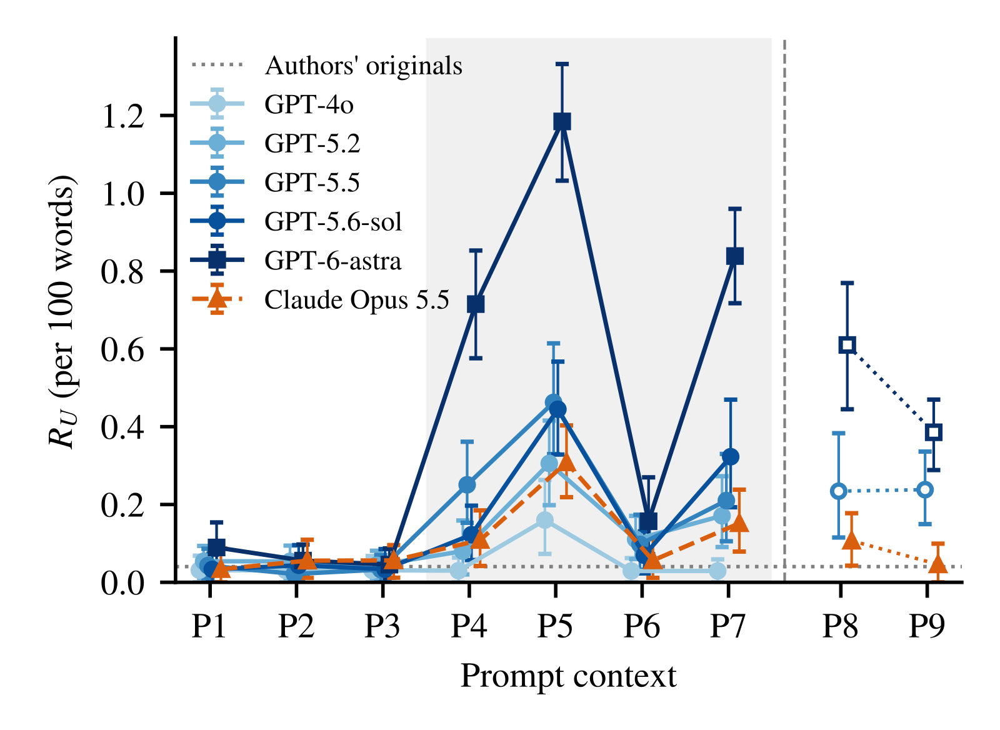

# Research background and figure guide

[Home](../README.md) · [简体中文](RESEARCH.zh-CN.md)

**Defensive Writing in GPT Models**

Junchi Liao, Xiao Huang, Yucheng Liu, Jiawen Deng, Fuji Ren

[Paper and abstract](https://arxiv.org/abs/2610.11355v2) · [Full text](https://arxiv.org/html/2610.11355v2)

## 1. The research question

The paper distinguishes evidence-grounded corrections from qualifications unsupported by the supplied material, and compares writing requests, model versions and review feedback.

## 2. Figure 1: The writing and review loop

Read left to right: the author's claim, GPT's revision, then the AI reviewer's and human reader's responses. Compare the added qualification with the two responses.

## 3. Table 1: Read the measures

- **Rᵤ:** ungrounded qualifications per 100 words.
- **Nov / Con / Res / Dis:** novelty, contribution, result analysis and discussion.
- **Ret / Soft:** shares of author claims retracted or softened.
- **Rewriting / Writing from evidence:** revision of a paragraph versus drafting from an evidence sheet.

## 4. Figure 2: Versions and revisions

The horizontal axis lists GPT versions. The left axis measures qualifications; the right axis measures softening and retraction. Match each series to the legend and its axis.

## 5. Figure 3: Prompt contexts

P1–P9 identify writing requests; the vertical axis measures ungrounded qualifications per 100 words.

| Context | Request summary |
|---|---|
| P1 | Polish |
| P2 | Polish an internal technical report |
| P3 | Polish for conference submission |
| P4 | Revise for peer review |
| P5 | Address anticipated reviewer concerns |
| P6 | Improve acceptance chances |
| P7 | Revise for harsh reviewers |
| P8 | Revise for scientific accuracy |
| P9 | Match claim strength to evidence |

## 6. Related practice

| Task | Template |
|---|---|
| Improve language and structure | [DW-002 Minimal editing](library/en/clarity.md#dw-002) |
| Check each sentence's function | [DW-001 Sentence-level diagnosis](library/en/clarity.md#dw-001) |
| Answer actual review comments | [DW-012 Reviewer response](library/en/research.md#dw-012) |

Images: Liao et al., arXiv:2610.11355v2, CC BY 4.0. Charts use the paper's vector files; the overview uses its original PNG. Open an image for full resolution. [Sources and specifications](../assets/paper/README.md)
